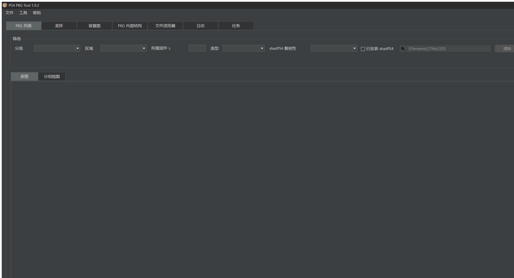

# PS4 PKG Tool 简体中文版

> 本仓库是 [pearlxcore/PS4-PKG-Tool](https://github.com/pearlxcore/PS4-PKG-Tool) 的 **简体中文分支**，界面、提示、报告与错误信息已完整汉化。
> 功能与上游保持一致（基线 v1.9.2），只改文案、不改逻辑。

<a href="https://trendshift.io/repositories/116703?utm_source=repository-badge&amp;utm_medium=badge&amp;utm_campaign=badge-repository-116703" target="_blank" rel="noopener noreferrer"></a>

[](https://github.com/pearlxcore/PS4-PKG-Tool/releases/latest)
[](LICENSE)
[]()



用于管理和查看 PS4 PKG 收藏的 Windows 桌面程序。

欢迎提建议。Bug 请提交到 [Issues](https://github.com/pearlxcore/PS4-PKG-Tool/issues)。

**本软件不用于获取盗版 PS4 游戏。**

---

## 目录

- [下载](#下载)
- [环境要求](#环境要求)
- [功能特性](#功能特性)
- [shadPS4 安装与使用](#shadps4-安装与使用)
- [PKG 查看器](#pkg-查看器)
- [资源管理器右键菜单](#资源管理器右键菜单)
- [游戏资产查看器](#游戏资产查看器)
- [Remote Package Installer 使用方法](#remote-package-installer-使用方法)
- [汉化说明](#汉化说明)
- [自行构建](#自行构建)
- [致谢与许可证](#致谢与许可证)

---

## 下载

| 版本 | 说明 |
|---|---|
| [**中文版 Release（v1.9.2-zh）**](https://github.com/rfooox/PS4PKGTool/releases/tag/v1.9.2-zh) | `PS4PKGTool-v1.9.2-zh-standalone.exe`（**126.8 MB**，自包含，免运行时）<br>`PS4PKGTool-v1.9.2-zh-framework-dependent.exe`（**16.2 MB**，框架依赖，需 .NET 10 Desktop Runtime） |
| [上游官方 Release（英文界面）](https://github.com/pearlxcore/PS4-PKG-Tool/releases/latest) | 由上游作者发布的官方版本 |
| **本仓库源码** | 完整中文界面，可自行构建，见 [自行构建](#自行构建) |

> Release 附件名使用 ASCII：GitHub 的附件上传接口不接受含空格与中文的文件名（返回 HTTP 404），附件名与程序界面的中文显示无关。

---

## 环境要求

- Windows 10 或更高版本（Windows 独占的 WinForms 程序）
- [.NET 10 Desktop Runtime](https://dotnet.microsoft.com/en-us/download/dotnet/10.0)（框架依赖版需要；自包含版不需要）

---

## 功能特性

**资源库管理**

- 清单缓存，启动快。扫描一次，之后秒开。
- 把 PKG 文件夹拖到窗口即可加载。
- 分组列表视图，可按标题、标题 ID、分类、系统版本或 PKG 类型分组。
- 按安装优先级、命名预设或自定义格式重命名 PKG。
- 按标题、分类、区域或类型把 PKG 移动整理到文件夹。

**PKG 查看与资产**

- 查看 PKG 信息：param.sfo、奖杯列表、条目与变更信息。
- 无需完整解压即可浏览并提取 PKG 内文件。
- 查看并提取 PKG 数据。
- 奖杯元数据查看器，含名称、描述与等级。
- 游戏资产查看器：图片、文本、音频元数据、Unity 资产 / Bundle、Unreal PAK 内容，以及十六进制兜底预览。

**打包操作与任务队列**

- 把选中的本体 PKG 与对应的更新 PKG 合并成一个游戏 PKG。
- 完整提取、合并 PKG、PKG 转 FFPFSC、**安装到 shadPS4** 都通过任务队列执行。
- 队列支持自动或手动处理，启动后仍保留任务。
- 完整提取、PKG 转 FFPFSC 与 shadPS4 安装支持多选 PKG；shadPS4 会先安装本体再装更新。

**OrbisPkgTool 库**

- 从 v1.8.0 起，PS4 PKG Tool 改用原生 C# 的 OrbisPkgTool 库处理受支持的 PKG 操作，不再调用 Sony 的 `orbis-pub-cmd.exe`。
- OrbisPkgTool 生成的包属实验性质，尚未在已越狱的 PS4 上充分测试。请自行备份，风险自负。

**实验性 PKG 转 FFPFSC**

- 把 PS4 PKG 转换为 FFPFSC 镜像，用于已越狱 PS5 上的 ShadowMountPlus。
- 该功能仍属实验性质，尚未在真实 PS5 硬件上验证。请保留原始 PKG，并在依赖转换结果前先校验输出。

**更新与兼容性**

- 「最新更新」列显示每个 PKG 可用的最新更新版本。
- 通过独立窗体下载官方更新 PKG。
- 按分类（游戏、补丁、附加内容、应用）筛选，或按文件名、标题、ID 搜索。
- 设置回移植标签并检查重复 PKG。
- 检查 PS5 向后兼容性。
- shadPS4 兼容性状态（Windows / Linux / macOS），并可下载缓存数据。

**shadPS4**

- 安装、启动并管理 shadPS4 上的 PS4 游戏。
- 管理 shadPS4 内核与启动器版本、游戏库安装、存档备份与启动诊断。
- 安装本体 PKG，并把更新合并进已有的 shadPS4 游戏安装。

**资源管理器集成**

- 资源管理器 `.pkg` 右键菜单：重命名、复制元数据、校验、解压与安装到 shadPS4。
- 通过文件关联，直接在独立 PKG 查看器中打开单个 `.pkg`。

**分享**

- 把 PKG 列表导出为 Excel。
- 通过 Remote Package Installer 在局域网上把 PKG 发送到 PS4。
- 生成持久化的兼容性报告与游戏反馈报告。

---

## shadPS4 安装与使用

PS4 PKG Tool 可以管理 shadPS4 版本、把自有 PS4 PKG 安装进 shadPS4 游戏库、启动游戏并管理存档备份。shadPS4 兼容性数据仅供参考；列出某个状态并不保证游戏一定能跑。

1. 打开「工具」>「shadPS4 管理器」。
2. 在「版本」选项卡中安装托管内核与启动器，或在「设置」选项卡中接管已有的 shadPS4 安装。
3. 选择当前使用的内核与启动器，必要时再选择 shadPS4 游戏安装目录。
4. 可选：在程序设置中启用 shadPS4 兼容性列，并下载兼容性数据。
5. 选中一个本体 PKG 和对应的更新 PKG，选择「安装到 shadPS4」。所选包会加入「任务」选项卡，本体排在更新之前。
6. 打开「工具」>「shadPS4 管理器」>「游戏」即可启动已安装的游戏。「存档」选项卡可在 shadPS4 关闭时创建与恢复存档备份。

在 shadPS4 变更存档或奖杯位置后首次启动，shadPS4 可能弹出**「存档迁移」**提示。选择「复制」以使用新位置，同时保留旧文件作为备份。该提示属于 shadPS4，与 PS4 PKG Tool 无关。

---

## PKG 查看器

双击单个 `.pkg` 文件，即可在 PS4 PKG Tool 的独立 PKG 查看器中直接打开。

查看器展示包详情、PARAM.SFO 数据、奖杯与封面信息、文件条目、解压工具，以及支持资产预览的文件浏览器。

要把 PS4 PKG Tool 设为 `.pkg` 的默认程序：

1. 右键点击 `.pkg` 文件，选择「打开方式」>「选择其他应用」。
2. 选择「PS4 PKG Tool」，或用「选择电脑上的应用」找到 `PS4 PKG Tool.exe`。
3. 勾选「始终使用此应用来打开 .pkg 文件」并确认。

---

## 资源管理器右键菜单

在「程序设置」>「资源管理器集成」>「安装集成」中安装当前用户级的右键菜单，**无需管理员权限**。Windows 11 下必要时点「显示更多选项」打开经典菜单。

右键菜单提供重命名格式、复制标题 / 标题 ID / Content ID、校验 PKG、解压 PKG 与安装到 shadPS4 等操作；在功能允许的菜单项上支持多选 `.pkg` 文件。

在程序设置中使用「移除集成」只会移除 PS4 PKG Tool 自己的右键菜单，不会改变 Windows 的 `.pkg` 默认关联。

---

## 游戏资产查看器

支持的预览包括 PNG、JPEG、BMP、GIF、DDS 与 PS4 GNF 贴图；文本文件；WAV、OGG 与 ATRAC9 元数据；以及无法识别文件的十六进制预览。Unity Bundle 与序列化的 `.assets` 文件可以浏览并查看其中的文件与受支持的 Texture2D 资产，若存在相邻的 `.resS` 流数据也会一并解析。未加密的 Unreal Engine 4 PAK 文件可以列出并浏览其中的条目。

部分游戏格式暂时还无法解码，包括加密归档与不支持的压缩 Unity Bundle。这些情况下查看器只显示可获取的元数据或十六进制预览，不会修改 PKG。

---

## Remote Package Installer 使用方法

仅兼容能运行 Flatz 版 Remote Package Installer 的 PS4 固件。目前不支持分卷更新的 PKG 文件。

- 打开程序设置。
- 填写本机与 PS4 的 IP 地址。
- 安装 Node.js 与 http-server 模块（确保 Node.js 能通过防火墙）。
- 若无法通过 PS4 PKG Tool 安装 http-server 模块，可尝试重启工具后重新安装；也可以手动执行 `npm install http-server -g`。
- 保存设置并退出程序设置。
- 在 PS4 上启动 Remote Package Installer 应用。
- 选中要安装的 PKG 文件，右键点击并选择「Send PKG to PS4」。

---

## 汉化说明

### 覆盖范围

界面文案、菜单、标签页、筛选区、右键菜单、任务队列状态、消息框、资产解析器元数据说明、兼容性报告与游戏反馈报告模板，全部已译为简体中文。

- 共替换 **2 642 条**英文文案，涉及 **129 个源文件**
- 对照表：[`docs/translation-table.md`](docs/translation-table.md) / [`docs/translation-table.csv`](docs/translation-table.csv)
- 翻译规则与术语表：[`docs/TRANSLATION_RULES.md`](docs/TRANSLATION_RULES.md)

### 刻意保留英文的内容

以下内容是跨文件的运行时契约，翻译会导致功能损坏或历史数据读不出来，因此**保持英文**：

| 类别 | 说明 |
|---|---|
| **主 PKG 列表的列名** | `Filename`、`Title`、`Title ID`、`Content ID`、`Region`、`Required Firmware`、`Version [App Version]`、`PKG Type`、`Category`、`Size`、`PSVR`、`PS4 Pro Enhanced`、`PS5 BC`、`Directory`、`Backported`、`Latest Update`、`ShadPS4`、`ShadPS4 Installed`、`Region Name`、`Required Firmware (Num)`。这些常量同时是 manifest 文件的 schema key，改了旧清单就读不出来 |
| **PKG 命名模板占位符** | `TITLE`、`TITLE_ID`、`APP_VERSION`、`CONTENT_ID`、`CATEGORY`、`CUSTOM NAME`、`RENAME BY INSTALL PRIORITY` |
| **取值型常量** | 区域 `UK` `EU` `US` `JAPAN` `HONG KONG` `ASIA` `KOREA`；分类 `Game` `Patch` `Addon` `App` `Uknown`；状态 `Fake` `Official` `Addon_Unlocker`；筛选 `ALL` `SELECTED` / `ALL` `IMAGE` `ICON` |
| **跨文件比较值** | `(unknown)`、`Cancelled`、任务类型 `Full Extract` / `Merge PKG` / `PKG → FFPFSC`（会被持久化到任务队列文件） |
| **资产元数据字典键** | `Sample Rate`、`Channels`、`Bit Depth`、`Duration`、`Pixel Format`、`Mip Maps`、`Texture Type`、`Unity Version`、`Ogg Version`、`Encrypted entries` |
| **品牌与协议名** | PS4、PS5、PKG、FPKG、shadPS4、OrbisPkgTool、Unity、Unreal、DLC、NPWR、NP Communication ID、CUSA、EP、PPSA |
| **其它** | GPU 名匹配串、字体名 `Segoe UI`、日期格式 `d MMMM yyyy` / `yyyy-MM-dd HH:mm`、路径 / URL / 命令 / 正则 / 占位符 |

程序内其它位置的说明文字（例如「按类型 / 按分类 / 按区域排序」）已经是中文，只有网格顶部的**列头**保持英文。若要彻底汉化列头，正确做法是加一层显示名映射（`HeaderText`），让列名常量与界面显示解耦。

### 汉化方式

采用**就地替换字符串字面量**，而不是 WinForms 的 `Localizable=true` + `.zh-CN.resx` 机制。好处是改动面可控、100% 保证编译通过、界面必然是中文；代价是源码里不再保留英文原文，需要回溯原文请查对照表。

---

## 自行构建

完整步骤见 [`BUILDING.md`](BUILDING.md)。简要版：

```powershell
# 1. 把两个依赖仓库克隆到本仓库的同级目录（文件夹名必须完全一致）
git clone https://github.com/pearlxcore/DarkUI.git
git clone https://github.com/pearlxcore/OrbisPkgTool.git

# 2. 需要 .NET 10 SDK
dotnet build PS4PKGTool\PS4PKGTool.sln

# 3. 发布单文件版
dotnet publish PS4PKGTool\PS4PKGTool.csproj -c Release
```

> **关于 DarkUI 依赖**：`BUILDING.md` 原先指向的 `EthanBlazkowicz/DarkUI` 其 master 分支（`b09d852`）缺少 `DarkTextBox.RefreshScrollBars` 与 `Placeholder` 成员，用它构建会编译失败。请改用 `pearlxcore/DarkUI`（master `9609e4e`，包含上述成员与同样的 DPI 修复）。

---

## 致谢与许可证

- [Robin Perris](https://github.com/RobinPerris)（DarkUI）
- [xXxTheDarkprogramerxXx](https://github.com/xXxTheDarkprogramerxXx)
- [Maxton (RIP)](https://github.com/maxton)
- [leecherman](https://sites.google.com/site/theleecherman/)
- [andshrew](https://github.com/andshrew)
- Sony <3

许可证：[GPL-3.0](LICENSE)

上游项目：[pearlxcore/PS4-PKG-Tool](https://github.com/pearlxcore/PS4-PKG-Tool)
